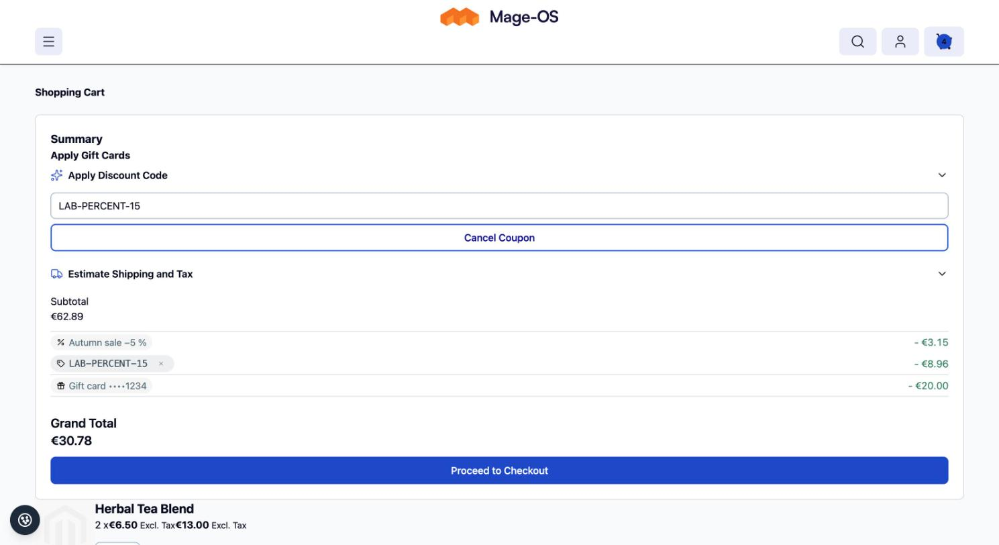
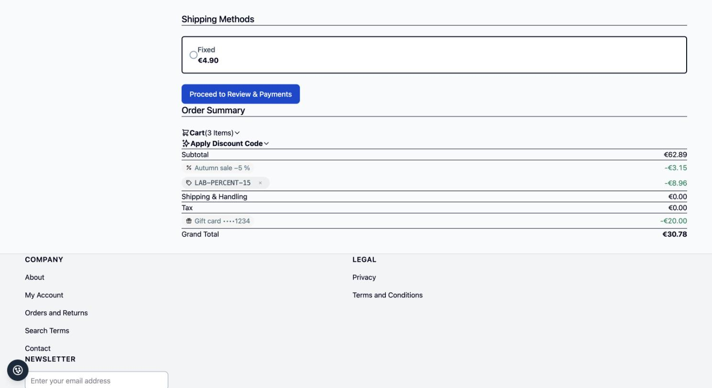

# Discount Lines for Mageplaza Gift Card

Adapter for [`pixelperfectat/magento2-module-discount-lines`](https://github.com/pixelperfectat/magento2-module-discount-lines):
redeemed [Mageplaza Gift Card](https://www.mageplaza.com/magento-2-gift-card/) codes appear as **masked gift card
lines** ("Gift card ••••1234") on the cart, in the checkout, on the order and in the sales emails and documents, one
line per redeemed card.

## Requirements

- `pixelperfectat/magento2-module-discount-lines`
- Mageplaza Gift Card (`mageplaza/module-gift-card`, commercial; not a hard dependency of this package, the module is
  sequenced after `Mageplaza_GiftCard` and reads only stored data)

Tested with `mageplaza/module-gift-card` 4.4.2. On Mage-OS 3.x with Symfony 7 and recent PHP, that vendor package needs
small patches (console command return types); this package does not ship such patches.

## Installation

```bash
composer require pixelperfectat/magento2-module-discount-lines-mageplaza-giftcard
bin/magento setup:upgrade
```

## How it works

Mageplaza books gift cards as its own `gift_card` totals segment, not as a sales rule discount, so the base module's
`discount` segment and its sum invariant are not touched. This adapter works on the gift card segment only:

- A plugin on the cart totals adds the masked lines (`extension_attributes.discount_lines`, kind `gift_card`) to the
  `gift_card` segment and replaces its title ("Gift card ••••1234" or "Gift cards (••••1111, ••••2222)"). The redeemed
  amount per card comes from Mageplaza's stored map (`mp_gift_cards`). The base-currency amount is the amount
  Mageplaza collected on the quote address (`base_gift_card_amount`); only if that is missing it is derived from the
  quote's base-to-quote rate.
- A plugin on the order totals block (order, invoice and credit memo, so emails, My Account and the admin) replaces
  Mageplaza's gift card row by one masked row per card, following the totals-row contract of the base module. For
  invoices and credit memos the card shares of the order are scaled to the document's gift card amount.
- A PDF total model prints the same masked lines in invoice and credit memo PDFs.
- Masking (`CodeMasker`): the last 4 characters stay visible, shorter codes are masked completely. The visible length
  and mask character are constructor arguments, overridable in `di.xml`.
- The module also registers a totals position (`sales/totals_sort/gift_card`, 50) because Mageplaza registers none.

## Configuration

Uses the base package settings under Stores > Configuration > Sales > Discount Lines (store-view scope): the master
switch `pp_discount_lines/general/enabled` (default `1`) turns the masked lines off. See the
[base README](https://github.com/pixelperfectat/magento2-module-discount-lines#configuration) for the full table.

## Contract

The lines follow the
[contract of the base README](https://github.com/pixelperfectat/magento2-module-discount-lines#contract-with-the-sales-email-module)
(kind `gift_card`, `rule_id` null, masked `code`).

## Known limits

- Mageplaza's own `gift_cards` JSON (the cart totals extension, the coupon box, the gift card list) shows codes
  according to Mageplaza's hidden-code setting. It lists codes the customer entered or owns and is outside the scope of
  this adapter, which covers the totals, emails, PDFs and order views.
- Codes of 5 to 7 characters still reveal their last 4 characters with the default masking; raise the minimum with the
  `CodeMasker` constructor arguments if that matters.
- Stores that override `sales/totals_sort` must add `gift_card` to their sort order.
- Invoices and credit memos get the order's card shares scaled to the document amount, so per-card amounts there can
  differ by a cent from the order.
- See the base README for the complete list of known limits.

## Screenshots

Placeholder data only, in `docs/screenshots/`:





## Development

```bash
composer install
composer check
```

`composer check` runs composer validate, PHP lint, PHP_CodeSniffer, PHPStan, PHPUnit and Infection mutation testing
(fails below MSI 85 or covered-code MSI 90). Infection needs a coverage driver: enable pcov, or Xdebug with
`XDEBUG_MODE=coverage`. `composer infection` runs the mutation tests on their own.

## License

MIT, see `LICENSE`.
